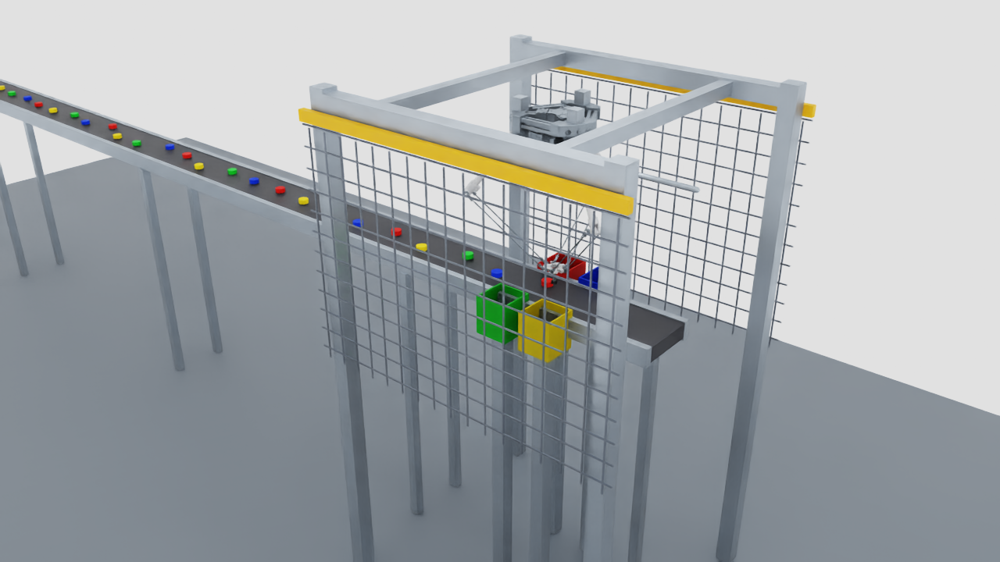

# Delta robot bottle-cap sorting

This workspace contains an Isaac Sim workcell and a ROS 2 application that detects caps in rendered RGB images, stops the conveyor, and controls the supplied Delta mechanism through physical joints. The original files in `Delta+Robot/` are unchanged.



The supported installation for this project is the one inspected on this machine: **Isaac Sim 6.0.0-rc.59, Ubuntu 24.04, ROS 2 Jazzy, Python 3.12, RTX 5070 Ti**. Isaac Sim 6 removed several older `isaacsim.core.api` classes; this project uses the APIs present in the installed release. Other Isaac versions have not been tested. See [validation](docs/validation.md) for measured results and limitations.

## Start the workcell

Run from a terminal on this machine:

```bash
cd /home/amin24/orca/deltarobot
./scripts/build.sh
./scripts/run_demo.sh
```

This starts five external ROS nodes and the Isaac Sim application. The GUI shows the overview camera. The task starts automatically once the simulation and ROS interfaces are ready. It parks the cup away from the camera's picking area, then begins feeding caps. By default, 24 caps are supplied and the task permits 24 attempts. An idle or exhausted belt stops after the configured timeout.

For a reproducible 20-attempt run that closes the simulator after evaluation:

```bash
DELTA_ATTEMPTS=20 DELTA_OUTPUT="$PWD/artifacts/my_run" \
  ./scripts/run_demo.sh --headless --max-time 700 --exit-on-complete
cat artifacts/my_run/results.json
```

`--max-time` is **simulation seconds**, not wall time. The CPU PhysX solver and RTX camera can run slower than real time. Without `--exit-on-complete`, the scene remains open after the task finishes. Ctrl+C closes the processes started by the launcher.

The launcher uses `ROS_DOMAIN_ID=42` unless you set another value. Set `ISAAC_SIM_PATH` if Isaac is installed elsewhere. `DELTA_CONFIG` selects a YAML file for **both** the simulator and ROS nodes; `DELTA_OUTPUT` selects the report directory. A rerun into the same report directory replaces that run's reports.

## Dependencies and rebuilding assets

The native ROS installation must supply the standard messages, actions, `tf2_ros`, `cv_bridge`, `colcon`, NumPy, SciPy, OpenCV, and PyYAML. The inspected machine already had these. On another Ubuntu 24.04 machine with a configured ROS apt repository:

```bash
sudo apt install ros-jazzy-desktop ros-jazzy-cv-bridge ros-jazzy-tf2-ros \
  ros-jazzy-rosidl-default-generators python3-colcon-common-extensions \
  python3-numpy python3-scipy python3-opencv python3-yaml python3-pytest python3-venv
```

The generated meshes and native USD scene are included in `assets/generated/`. The CAD conversion environment is separate from ROS and Isaac Python. To regenerate it:

```bash
python3 -m venv --system-site-packages .venv
.venv/bin/python -m pip install -r requirements-cad.txt
.venv/bin/python scripts/inspect_cad.py > artifacts/inspection/cad_parts.txt
.venv/bin/python scripts/derive_robot.py
.venv/bin/python scripts/prepare_visuals.py
cp assets/generated/robot_geometry.json ros2_ws/src/delta_sorting/config/robot_geometry.json
./scripts/build.sh
source /opt/ros/jazzy/setup.bash
"${ISAAC_SIM_PATH:-/home/amin24/isaacsim}/python.sh" sim/run_cell.py --headless --build-only
```

Do not activate `.venv` before starting Isaac Sim or ROS nodes. It is only for CAD conversion and offline asset inspection. No remote Isaac asset pack is required; the scene is generated locally.

## Files

| Path | Purpose |
| --- | --- |
| `assets/generated/sorting_cell.usdc` | Native, self-contained USD workcell with the physical robot, conveyor, caps, bins, camera, lights, frame, and guards |
| `assets/generated/robot_geometry.json` | Measured mechanism coordinates and mapping back to STEP instances |
| `assets/generated/visuals.npz` | Simplified meshes made from the actual STEP assembly |
| `sim/scene.py` | Reproducible USD scene authoring |
| `sim/ros_bridge.py` | Images, calibration, TF, clock, measured joint states, physical joint drives, conveyor, vacuum and stop/reset services |
| `sim/run_cell.py` | Isaac application entry point |
| `ros2_ws/src/delta_interfaces` | Typed visual detections, targets, and motion action |
| `ros2_ws/src/delta_sorting` | Perception, projection, kinematics/motion, task state machine, evaluator, configuration and launch |
| `artifacts/inspection/` | Source checksums, CAD inventory, environment manifest and test output |
| `artifacts/<run>/` | Events, actual results, camera PNGs, runtime summary and logs |

Opening `sorting_cell.usdc` alone lets you inspect or simulate the physical scene. Start it with `run_cell.py` and the ROS launch file for autonomous behavior; the USD does not embed the external ROS task application.

## Control and troubleshooting

In a separate terminal, use the same ROS domain:

```bash
source /opt/ros/jazzy/setup.bash
source /home/amin24/orca/deltarobot/ros2_ws/install/setup.bash
export ROS_DOMAIN_ID=42
ros2 topic echo /sorting/state
ros2 topic hz /camera/image_raw
ros2 topic echo /caps/targets
```

Safe stop and resume:

```bash
ros2 service call /sorting/stop std_srvs/srv/Trigger '{}'
# Stop holds the current joints, stops the belt, and retains any vacuum attachment.
# With an empty cup:
ros2 service call /cell/reset std_srvs/srv/Trigger '{}'
ros2 service call /sorting/reset std_srvs/srv/Trigger '{}'
```

If stopped with a cap held, inspect its location before releasing vacuum. `/gripper/set_enabled` with `data: false` releases it at its **current physical location**. Reset never teleports or respawns caps. Restart the application to refill the conveyor.

- **No ROS topics:** check the domain, source Jazzy and this workspace, and inspect `isaac.log` for the ROS bridge startup. The runtime probe is `scripts/probe_isaac.py` with Isaac's `python.sh`.
- **No picks:** inspect saved RGB images, `/caps/pixels`, and `/caps/targets`. The robot deliberately rejects occluded/adjacent caps, ambiguous colors, old frames, and points outside the belt ROI or reachable region. The plate can obscure the view until homing completes.
- **Motion rejected:** the complete tool path must meet joint limits, conservative workspace bounds, and belt/bin clearance checks. Changing bin positions requires validating their paths. An action rejection is a failed operation, not a placement success.
- **Vacuum fails:** the cup must be within 7 mm laterally and 4 mm vertically of an upright cap's top surface, with the belt stopped. Inspect the RGB calibration and physical tool feedback. The task retries the seal once, then lifts, returns home, and feeds the failed target out.
- **Motion timeout or held-cap fault:** the task enters a latched stop instead of dropping the cap or resuming the belt. Inspect the scene, clear the cup safely, and reset.
- **Clock stops:** motion has a wall-time feedback watchdog; no timeout can advance on a paused simulation clock. Other task transitions resume when `/clock` resumes. The adapter holds its last drive target on a missed command stream.
- **Clean shutdown logs:** the installed Isaac release may print renderer/plugin teardown warnings. The ROS node entry points catch normal shutdown exceptions.

## Configuration and documentation

Edit [cell.yaml](ros2_ws/src/delta_sorting/config/cell.yaml), or copy it and set `DELTA_CONFIG` to your copy. Restart for configuration changes. Camera calibration, object dimensions, bin geometry and control parameters must stay consistent across all nodes; the launcher handles this by passing one file to every process.

- Add a cap color to `caps.colors`, `perception.hue_ranges`, and `bins` together. Hue uses OpenCV's 0–179 range. RGB material values are linear values in 0–1. Bins and recognized colors must match exactly.
- Tune segmentation area, circularity, solidity, saturation, value and confidence under `perception`. Changes in camera distance/focal length also change pixel area.
- Change `conveyor.speed`, `caps.spacing`, `caps.count`, and `caps.seed` for supply variation. Keep the cap train within the configured belt length; the picking area remains near the downstream end.
- Change `bins` and `bin_geometry` for collection layout. The current source robot is small: 178/245 mm links. Test reachability and clearance before moving bins farther away.
- Change `robot.cartesian_speed`, `approach_speed`, `joint_speed`, and `joint_acceleration` to tune motion. The full path is prechecked and time-scaled. Joint limits in `robot_geometry.json` are assumed commissioning limits, not measured hardware limits.

Further details: [architecture and ROS interfaces](docs/architecture.md), [model and kinematics](docs/robot_model.md), [vision and calibration](docs/perception.md), [validation and remaining work](docs/validation.md).

Run the deterministic unit tests with `python3 -m pytest -q tests`. [Validation](docs/validation.md) describes the live fault tests and measured autonomous runs.
