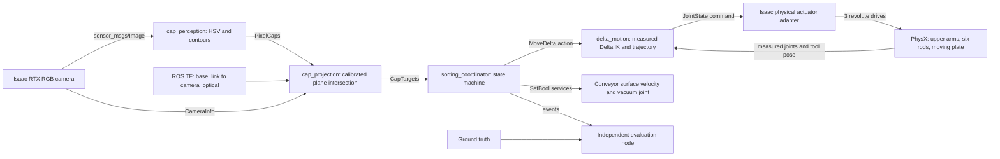

# Architecture and control flow

The simulator provides physical sensors and actuators. All image classification, target projection, kinematics, trajectory generation, and sorting decisions run in external ROS 2 processes. The Python adapter inside Isaac uses its supported `rclpy` integration after enabling `isaacsim.ros2.bridge`; it runs no sorting policy.

All five external nodes use `use_sim_time=true`. `/clock` is the time reported by `SimulationManager`; it advances with PhysX, including manual stepping. Image timestamps refer to the rendered physics state. Static transforms and camera calibration share a single configuration. Camera capture runs at 10 Hz, joint/tool feedback at 60 Hz, and ROS joint trajectory commands at 50 Hz. Physics runs at 240 Hz; there is no requirement to run at wall-clock speed.

## Interfaces

| Name | Type | Producer → consumer | Meaning |
| --- | --- | --- | --- |
| `/camera/image_raw` | `sensor_msgs/Image`, RGB8 | Isaac → perception | Actual rendered RGB, sensor-data QoS |
| `/camera/camera_info` | `sensor_msgs/CameraInfo` | Isaac → projection | Pinhole K/P, zero distortion, sensor-data QoS |
| `/caps/pixels` | `delta_interfaces/PixelCaps` | perception → projection | Pixel centers, radius, color, confidence, rejected count |
| `/caps/targets` | `delta_interfaces/CapTargets` | projection → coordinator | Cup contact points in `base_link`, color, confidence |
| `/delta/move_to` | `delta_interfaces/action/MoveDelta` | coordinator → motion | Translation in `base_link` and maximum tool speed; result includes success/reason |
| `/delta/joint_command` | `sensor_msgs/JointState` | motion → Isaac | Ordered `shoulder_0..2`, radians, stamped command |
| `/joint_states` | `sensor_msgs/JointState` | Isaac → motion/visualization | Measured rotations and angular velocities of physical upper bodies |
| `/delta/tool_pose` | `geometry_msgs/PoseStamped` | Isaac → motion | Measured physical cup pose in `base_link`; used for tracking, not visual target selection |
| `/conveyor/set_running` | `std_srvs/SetBool` | coordinator → Isaac | Start/stop belt contact-surface velocity |
| `/gripper/set_enabled` | `std_srvs/SetBool` | coordinator → Isaac | Attempt a vacuum seal or release the attachment |
| `/conveyor/running`, `/gripper/attached` | `std_msgs/Bool` | Isaac → task/diagnostics | Actuator feedback |
| `/cell/estop` | `std_srvs/SetBool` | operator/task → Isaac | `true` latches physical stop; clearing requires reset |
| `/cell/reset` | `std_srvs/Trigger` | operator → Isaac | Clear stop with empty cup; preserve all object poses |
| `/cell/estopped` | `std_msgs/Bool`, transient-local | Isaac → task/motion | Latched stop status |
| `/sorting/stop`, `/sorting/reset` | `std_srvs/Trigger` | operator → coordinator | Stop or resume task policy |
| `/sorting/state`, `/sorting/events` | `std_msgs/String` | coordinator → diagnostics/evaluator | State name and structured JSON attempt events |
| `/tf`, `/tf_static`, `/clock` | standard ROS types | Isaac → ROS | Frames and simulation time |
| `/evaluation/ground_truth` | `std_msgs/String` | Isaac → evaluator **only** | Cap IDs, true colors and poses for scoring; no production node subscribes |
| `/evaluation/done` | `std_msgs/Bool` | evaluator → optional runtime exit | End-of-run signal |

No object name, material color label or cap pose is passed to perception, projection, or task selection. The gripper checks nearby physical sealing surfaces as an actuator simulation; it never chooses a target color. The evaluation adapter includes true labels on its separate scoring channel.

## State machine

1. `INIT → BOOT_STOP → BOOT_RELEASE → HOMING`: wait for services/feedback, stop belt, open cup, move home.
2. `FEED_START → FEED`: feed caps while examining fresh visual targets.
3. `STOPPING → SETTLE`: acknowledge belt stop and allow 0.6 simulation seconds to settle.
4. `DETECT`: require an image newer than settling; select a confident, isolated, reachable target. If none arrives in 3 seconds, resume feeding.
5. `APPROACH → DESCEND → GRIP`: move above the target, descend vertically, request vacuum.
6. `LIFT`: lift vertically and verify physical attachment feedback.
7. `TRANSFER → BIN_DESCEND`: travel above the appropriate bin and lower to release height, staying above the rim.
8. `RELEASE → VERIFY_RELEASE → RETURN`: open the cup, verify release, return home to clear the camera.
9. Re-enter `DETECT` while the belt remains stopped; feed again when no valid cap remains. Stop after the attempt limit or supply timeout.

Actions are asynchronous; service and action operations have 16-second simulation-time deadlines. The motion controller separately checks tracking, joint state freshness, action cancellation, and a wall-time watchdog. The adapter enforces command shape, names, finite values, joint limits, freshness and joint speed. It holds position if ROS commands stop.

A failed seal is retried once. If it still fails, the task reports a failed attempt, opens the cup, lifts, returns home, and runs the belt for at least 3.5 seconds before selecting another target. Failure with a held cap or failure during recovery latches a stop. Stop retains suction. Reset does not clear the floor or reposition objects.

The evaluator counts an attempt when the task commits to a visual target. A successful pick requires an actual attached cap to rise at least 35 mm above the belt. A correct placement requires the released cap's center to settle inside the matching bin, including radial clearance for its size and the bin's height range. A release command alone is not counted as success.
